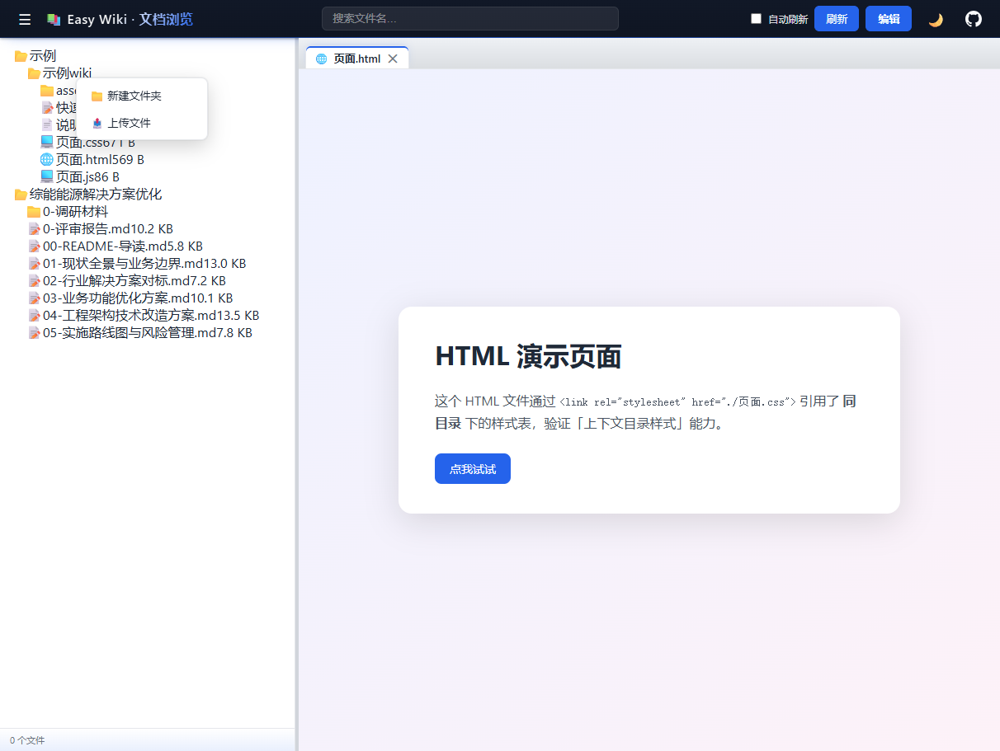
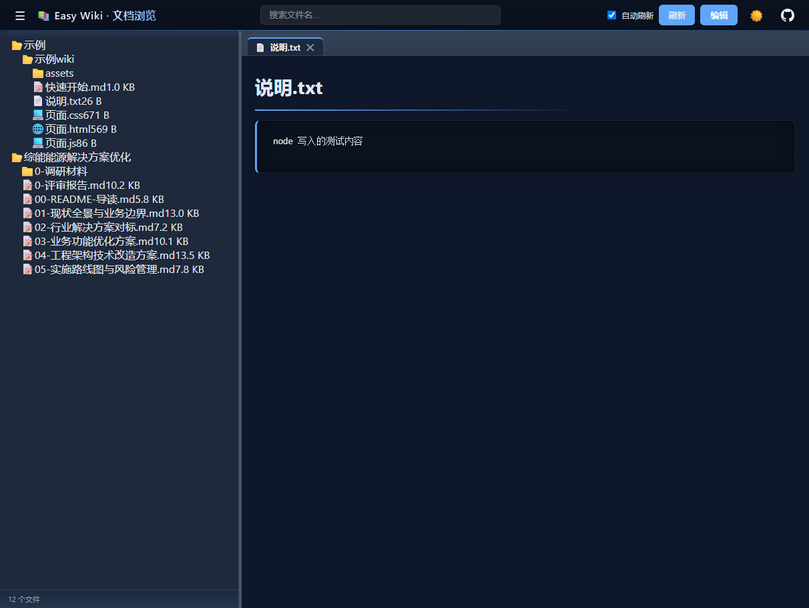
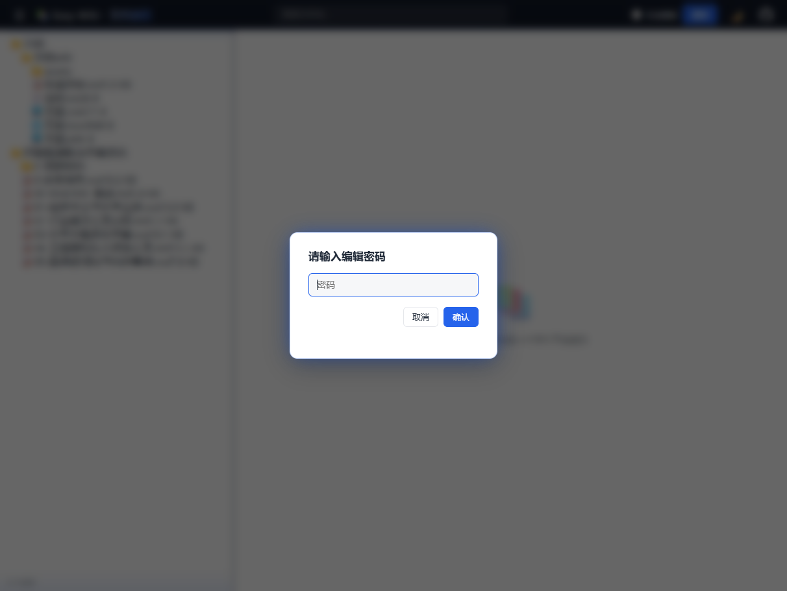

# Easy Wiki · 团队文档分享与展示工具

[English](README_EN.md) | **中文**

<div align="center">

📚 **一条命令，把文件夹变成团队的文档站** —— 项目方案 / AI 生成的 Markdown / 会议议案 / 学习笔记，放进目录即可分享。

[](https://nodejs.org)
[](https://opensource.org/licenses/MIT)
[](http://makeapullrequest.com)

### 🌟 如果这个项目帮到了你，欢迎 Star ⭐ 支持一下！

</div>

## 这是什么

Easy Wiki 是一个轻量的团队文档分享工具。把要分享的文档放进一个文件夹，跑一条 `node server.js`，团队里的每个人打开浏览器就能看到排版好的文档——有目录树导航、文件名搜索、多标签页，还能在线编辑、上传文件、新建目录。

没有构建步骤，没有账号系统。文件放进目录，刷新即可见；配置改完，一秒生效。

## 为什么做这个工具

团队里的文档正变得越来越多：AI 工具生成的调研报告、写成 Markdown 的技术方案、会议记下来的议案、日常积累的学习笔记……分享这些内容时，常见的做法各有各的麻烦：

- **IM / 邮件直接发文件** —— 接收方要下载才能看，`.md` 双击打开可能是记事本；改一版发一版，很快就没人说得清哪个是最新的
- **共享盘 / NAS** —— 要挂载、要配权限；阅读体验取决于对方本地装了什么软件，Markdown 基本没法舒服地读
- **在线文档平台** —— 要注册、要导入、要学着用；分享一篇文档前的准备工作比写文档还长

Easy Wiki 把这件事倒过来做：**不动文档本身，不改变任何人的写作习惯，只是把「放文档的文件夹」变成「能看、能搜、能编辑的网页」**。写好新文档丢进目录，发个链接，大家打开就是干净的阅读界面；自己留档的仍然是原始文件，随时可以用任何编辑器继续写。

## 界面

主界面 —— 左侧目录树导航，右侧多标签阅读：



Markdown / 文本 / JSON / YAML / 代码等多种格式都能直接阅读，带语法高亮：



编辑、上传、新建目录等写操作需要密码，团队共享一个密码即可，无需账号系统：



## 核心特性

- **零构建、零框架** —— 纯 Node.js 实现，仅 markdown-it 和 highlight.js 两个依赖，`node server.js` 即可运行
- **多格式阅读** —— Markdown（完整 GFM + 代码高亮 + frontmatter 元数据）、JSON / YAML / 20 余种代码（语法高亮）、HTML 原样展示；Markdown 内的相对图片与链接自动解析
- **多根目录** —— 一个页面同时挂载多个文档目录，不同项目、不同团队的文档集中浏览
- **实时读盘** —— 每次请求读取磁盘最新状态，文件增删改刷新即见，无需重启
- **文件搜索** —— 按文件名即时过滤目录树，快速定位文档
- **多标签浏览** —— 三种标签模式（单页 / 按类型 / 多标签），可同时打开多篇文档对照阅读
- **在线编辑** —— 密码验证后直接在浏览器中修改文档，`Ctrl+S` 保存，即时生效
- **上传与新建** —— 右键目录即可上传文件、创建子目录，远程维护文档无需登录服务器
- **暗色模式** —— 一键切换并记忆偏好
- **配置热更新** —— `web.config` 修改保存约 1 秒生效，支持 `//` 注释
- **编码自适应** —— 自动识别 UTF-8 / GBK，中文文本文件不乱码
- **访问边界** —— 仅暴露配置内的目录，路径穿越一律拒绝

## 快速开始

### 1. 安装

```bash
git clone https://github.com/endcy/easy-wiki.git
cd easy-wiki
npm install    # 只有 markdown-it 和 highlight.js 两个依赖
```

### 2. 配置

编辑根目录的 `web.config`（支持 `//` 注释），把要分享的目录挂上来：

```jsonc
{
  "port": 82,
  "bind": "0.0.0.0",          // 局域网内所有人可访问
  "title": "团队文档",
  "editPassword": "123456",    // 编辑/上传密码，留空则关闭写功能
  "tabMode": "multi",          // single / perType / multi
  "roots": [
    { "name": "项目方案", "path": "D:/docs/project-a" },
    { "name": "团队Wiki", "path": "D:/docs/wiki" }
  ]
}
```

### 3. 启动

```bash
node server.js          # 前台运行
./restart.sh            # Linux / macOS 后台运行（自动停旧起新）
restart.bat             # Windows
```

然后把 `http://<你的IP>:82` 发给同事，分享就开始了。

## 常用配置

| 字段 | 默认 | 说明 |
|------|------|------|
| `port` | `82` | 监听端口 |
| `bind` | `0.0.0.0` | `0.0.0.0` 局域网可访问；`127.0.0.1` 仅本机 |
| `title` | — | 页面标题（顶栏 + 浏览器标签） |
| `editPassword` | — | 写操作密码；留空则禁用编辑 / 上传 / 新建 |
| `tabMode` | `multi` | 标签模式：`single` / `perType` / `multi` |
| `maxTabs` | `10` | `multi` 模式下的标签数量上限 |
| `roots` | 必填 | 文档根目录数组，每项 `{ name, path }`，`name` 需唯一 |
| `ignore` | 内置常见项 | 忽略规则（如 `node_modules`、`*.log`） |

其余字段（`ignoreHidden`、`autoRefreshSeconds` 等）见 `web.config` 内注释；修改后热加载，无需重启。

## 快捷键

| 快捷键 | 作用 |
|--------|------|
| `Ctrl/Cmd + S` | 保存编辑中的文档 |
| `Ctrl/Cmd + W` | 关闭当前标签 |
| `Esc` | 关闭弹窗 |

## 安全说明

- 只有 `roots` 里配置的目录可访问，`..`、符号链接等路径穿越一律拒绝
- 密码明文保存在 `web.config`，请设置得复杂些，并且**不要把工程目录本身设为 root**（避免 `web.config`、`node_modules` 被浏览）
- 定位是团队内网工具，不建议不做防护直接暴露公网

## 常见问题

<details>
<summary>端口被占用？</summary>

```bash
./restart.sh     # Linux / macOS：自动停掉旧进程再启动
restart.bat      # Windows：同样自动处理
```
</details>

<details>
<summary>改了配置没生效？</summary>

配置约 1 秒轮询热加载。确认文件已真正保存（某些编辑器会写临时文件），或直接重启服务。
</details>

<details>
<summary>中文 txt 打开乱码？</summary>

服务端自动识别 UTF-8 / GBK；仍乱码多半是 UTF-16 等其它编码，建议转存为 UTF-8。
</details>

<details>
<summary>Markdown 里的图片显示不出来？</summary>

图片需要放在 `roots` 配置的目录内，路径相对 md 文件书写；服务端会自动把相对路径改写为可访问的链接。
</details>

## 环境与部署

**环境要求**

- Node.js ≥ 18（Windows / Linux / macOS 均可运行）
- 服务器能访问到文档目录（本机磁盘或已挂载的共享目录）
- 团队成员用浏览器访问即可，无需安装任何东西

**Linux 服务器常驻（推荐 systemd）**

```ini
# /etc/systemd/system/easy-wiki.service
[Unit]
Description=Easy Wiki
After=network.target

[Service]
WorkingDirectory=/opt/easy-wiki
ExecStart=/usr/bin/node server.js
Restart=always

[Install]
WantedBy=multi-user.target
```

```bash
sudo systemctl daemon-reload
sudo systemctl enable --now easy-wiki
```

不需要常驻服务时，也可以用脚本后台运行：`./restart.sh`（nohup 启动，日志写入 `log/server.log`）。

**Windows**

直接 `node server.js`，或用 `restart.bat` 一键重启；需要开机自启可加一条计划任务。

**端口与防火墙**

默认监听 82 端口。局域网访问前记得放行：

```bash
sudo ufw allow 82          # Ubuntu
# 或对应云服务器安全组 / Windows 防火墙入站规则放行 82
```

**让团队访问**

- 内网：`bind: "0.0.0.0"`，同事访问 `http://<你的IP>:82`
- 需要外网或 HTTPS 时，建议前置 nginx 反向代理，不要把服务直接暴露公网

## License

[MIT](LICENSE) — 个人与商业项目均可自由使用。

---

<div align="center">

**Author:** [endcy](https://github.com/endcy) · **GitHub:** [endcy/easy-wiki](https://github.com/endcy/easy-wiki)

如果这个项目帮到了你，欢迎 Star ⭐

</div>
