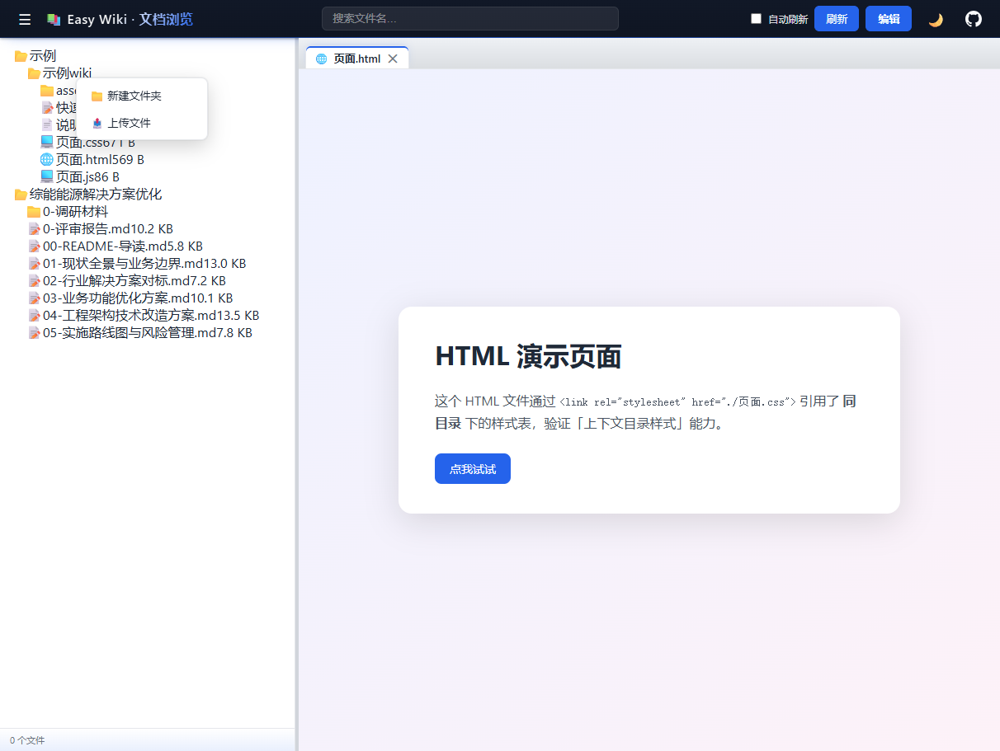
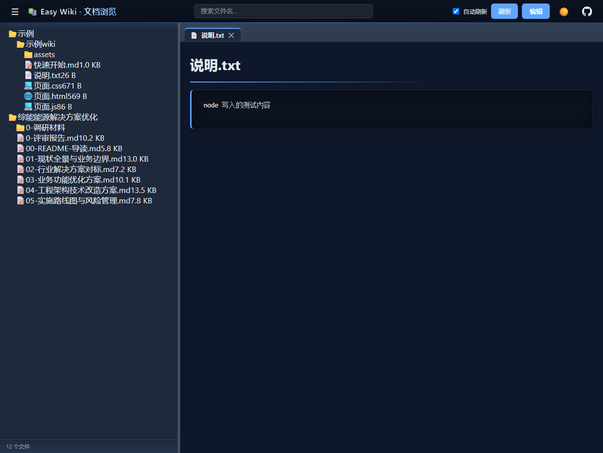
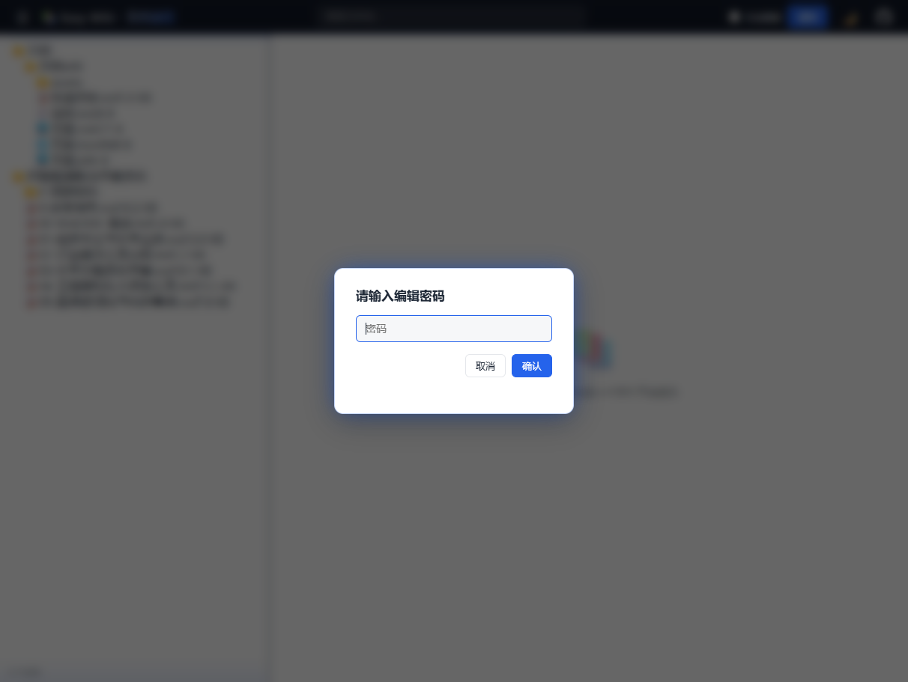

# Easy Wiki · Team Document Sharing & Display

**English** | [中文](README.md)

<div align="center">

📚 **One command turns any folder into your team's documentation site** — project proposals, AI-generated Markdown, meeting notes, study notes. Drop files in, share the link.

[](https://nodejs.org)
[](https://opensource.org/licenses/MIT)
[](http://makeapullrequest.com)

### 🌟 If this project helps you, please consider giving it a Star ⭐!

</div>

## What is this

Easy Wiki is a lightweight tool for sharing documents with your team. Put the documents you want to share into a folder, run `node server.js`, and everyone on the team can open a browser and read them properly formatted — with a folder tree, file search, multiple tabs, plus inline editing, file upload, and directory creation.

No build step. No account system. Drop a file in, refresh, it's there. Change the config, it applies within a second.

## Why this tool exists

Teams are producing more documents than ever: research reports generated by AI tools, technical proposals written in Markdown, meeting decisions, notes accumulated along the way… When it comes to sharing them, the usual approaches each carry their own friction:

- **Sending files over IM / email** — recipients must download before reading; a `.md` file might open in Notepad. After a few revisions nobody can tell which version is current
- **Shared drives / NAS** — requires mounting and permission setup; the reading experience depends on whatever software the other person has installed, and Markdown is nearly unreadable
- **Online doc platforms** — requires signup, import, and learning the platform; preparing to share a single document takes longer than writing it

Easy Wiki flips this around: **it doesn't touch your documents or change anyone's writing habits — it simply turns "the folder where documents live" into "a web page people can read, search, and edit"**. Write a new document, drop it in the folder, share the link, and everyone gets a clean reading interface. The originals stay on disk untouched, ready to keep editing in any editor.

## Screenshots

Main interface — folder tree on the left, multi-tab reading on the right:



Markdown / plain text / JSON / YAML / code files all render directly with syntax highlighting:



Write operations (edit, upload, create directory) require a password — one shared password for the team, no account system needed:



## Key features

- **Zero build, zero framework** — pure Node.js with just two dependencies (markdown-it + highlight.js); `node server.js` and you're running
- **Multi-format reading** — Markdown (full GFM + code highlighting + frontmatter), JSON / YAML / 20+ code languages (syntax highlighted), HTML served as-is; relative images and links inside Markdown are resolved automatically
- **Multiple roots** — mount several document folders in one page; docs from different projects and teams in a single view
- **Live disk reads** — every request reads the disk fresh; file additions and changes show up on refresh, no restart needed
- **File search** — filter the folder tree by name to locate documents instantly
- **Multi-tab browsing** — three tab modes (single / per-type / multi), open several documents side by side for cross-reading
- **Inline editing** — edit documents directly in the browser after password verification; `Ctrl+S` saves and takes effect immediately
- **Upload & create** — right-click a folder to upload files or create subdirectories; maintain documents remotely without logging into the server
- **Dark mode** — one-click toggle, remembers your preference
- **Hot-reloading config** — save `web.config` and it applies in ~1 second; `//` comments supported
- **Encoding aware** — auto-detects UTF-8 / GBK, Chinese text files display correctly
- **Access boundary** — only configured directories are exposed; path traversal is always rejected

## Quick start

### 1. Install

```bash
git clone https://github.com/endcy/easy-wiki.git
cd easy-wiki
npm install    # just markdown-it and highlight.js
```

### 2. Configure

Edit `web.config` in the project root (`//` comments supported) and mount the folders you want to share:

```jsonc
{
  "port": 82,
  "bind": "0.0.0.0",          // accessible to everyone on the LAN
  "title": "Team Docs",
  "editPassword": "123456",    // password for edit/upload; empty disables write features
  "tabMode": "multi",          // single / perType / multi
  "roots": [
    { "name": "project-a", "path": "D:/docs/project-a" },
    { "name": "team-wiki", "path": "D:/docs/wiki" }
  ]
}
```

### 3. Run

```bash
node server.js          # foreground
./restart.sh            # Linux / macOS background (stops old, starts new)
restart.bat             # Windows
```

Then send `http://<your-ip>:82` to your teammates — that's the whole sharing setup.

## Configuration reference

| Field | Default | Description |
|-------|---------|-------------|
| `port` | `82` | Listen port |
| `bind` | `0.0.0.0` | `0.0.0.0` = LAN accessible; `127.0.0.1` = local only |
| `title` | — | Page title (topbar + browser tab) |
| `editPassword` | — | Password for write operations; empty disables edit / upload / create |
| `tabMode` | `multi` | Tab mode: `single` / `perType` / `multi` |
| `maxTabs` | `10` | Tab limit in `multi` mode |
| `roots` | required | Document roots, each `{ name, path }`; `name` must be unique |
| `ignore` | built-in list | Ignore rules (e.g. `node_modules`, `*.log`) |

Additional fields (`ignoreHidden`, `autoRefreshSeconds`, …) are documented inside `web.config`; changes hot-reload without restart.

## Keyboard shortcuts

| Shortcut | Action |
|----------|--------|
| `Ctrl/Cmd + S` | Save the document being edited |
| `Ctrl/Cmd + W` | Close current tab |
| `Esc` | Close dialog |

## Security notes

- Only directories listed in `roots` are accessible; `..` and symlink traversal are rejected
- The password is stored in plain text in `web.config` — use a strong one, and **do not set the project directory itself as a root** (that would expose `web.config` / `node_modules`)
- Designed as an intranet team tool; don't expose it directly to the public internet

## FAQ

<details>
<summary>Port already in use?</summary>

```bash
./restart.sh     # Linux / macOS: kills the old process and starts a new one
restart.bat      # Windows: handles it automatically
```
</details>

<details>
<summary>Config changes not applying?</summary>

The config hot-reloads on a ~1 second poll. Make sure the file was actually saved (some editors write temp files first), or restart the server.
</details>

<details>
<summary>Chinese text files garbled?</summary>

The server auto-detects UTF-8 / GBK. If still garbled, the file is likely UTF-16 or another encoding — converting it to UTF-8 is recommended.
</details>

<details>
<summary>Markdown images not loading?</summary>

Images must live inside a configured `roots` directory, referenced relative to the md file; the server rewrites relative paths into accessible links automatically.
</details>

## Environment & deployment

**Requirements**

- Node.js ≥ 18 (runs on Windows / Linux / macOS)
- The server can reach your document directories (local disk or mounted shares)
- Team members only need a browser — nothing to install on their side

**Linux server (systemd, recommended for always-on)**

```ini
# /etc/systemd/system/easy-wiki.service
[Unit]
Description=Easy Wiki
After=network.target

[Service]
WorkingDirectory=/opt/easy-wiki
ExecStart=/usr/bin/node server.js
Restart=always

[Install]
WantedBy=multi-user.target
```

```bash
sudo systemctl daemon-reload
sudo systemctl enable --now easy-wiki
```

For simple background runs without systemd: `./restart.sh` (nohup, logs to `log/server.log`).

**Windows**

Run `node server.js` directly, or use `restart.bat` for one-click restart; add a scheduled task for auto-start on boot.

**Port & firewall**

The default port is 82. Open it before sharing on the LAN:

```bash
sudo ufw allow 82          # Ubuntu
# or the equivalent cloud security group / Windows firewall inbound rule
```

**Sharing with the team**

- Intranet: set `bind: "0.0.0.0"` and share `http://<your-ip>:82`
- For public access or HTTPS, put nginx in front as a reverse proxy — don't expose the service directly

## License

[MIT](LICENSE) — free for personal and commercial use.

---

<div align="center">

**Author:** [endcy](https://github.com/endcy) · **GitHub:** [endcy/easy-wiki](https://github.com/endcy/easy-wiki)

If this project helps you, a Star ⭐ is appreciated!

</div>
